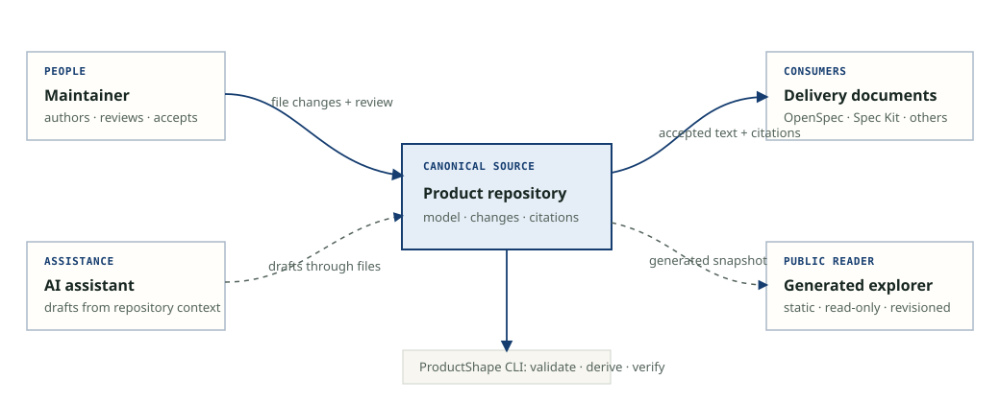

# Context and Scope

## Business Context

ProductShape reads and writes product-definition files in the adopter's repository. It derives validation results, graph views, citations, integration files, and snapshots. Delivery tools consume accepted product text through citations; they do not become another store for ProductShape truth.

## Technical Context

| Partner | Information exchanged | Technical channel |
| --- | --- | --- |
| Repository maintainer | Authored model, Product Changes, configuration | Local files and version control |
| AI assistant | Drafts and questions grounded in repository context | Generated provider skills/commands and CLI invocation |
| OpenSpec and Spec Kit workspaces | Product Changes or consumer citations, according to the selected integration | Files installed or read by the corresponding integration package |
| CI | Validation, citation status, release and conformance results | GitHub Actions invoking built CLI commands |
| npm consumers | Published CLI package | npm registry |
| Public documentation reader | Informational pages and a generated model snapshot | Static GitHub Pages deployment |

## Input and Output Channel Mapping

The CLI is the local interface for authoring support, validation, citation checks, and derived views. Git review is the acceptance boundary for repository changes. The public site contains no write path to the product model.

<!-- pdac:cite id="CON-MARKDOWN-001" digest="sha256:e1d4c39d7e5fc5f1a1573dbb6433986a26248289c9a97c11bb039db7af0f5c17" -->

<!-- pdac:cite id="UC-INIT-001" digest="sha256:82f4a1b7f382d5f60b2c02257213e35c9e9e7ebb4f438123d2bd5f0e31a6f86c" -->
