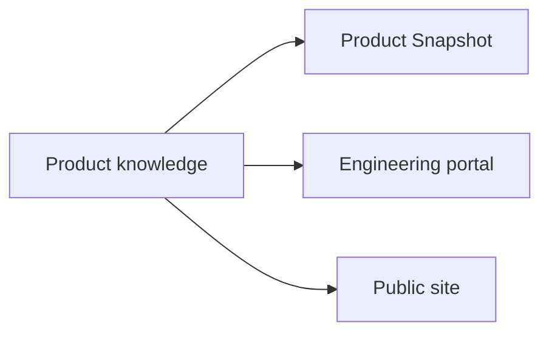

# ProductShape publication relationships

This authored view explains how product knowledge becomes the Product Snapshot,
engineering portal and public site. It is explanatory documentation, not canonical
Product Model data.

